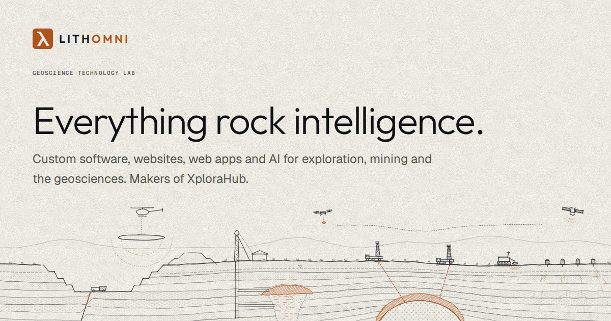

**[Lithomni Technologies](https://lithomni.com)** is a geoscience technology lab. We build custom software, websites, web apps and AI for exploration, mining and the wider geosciences. *Lith·omni*, from the Greek *lithos*, stone, and the Latin *omnis*, all: everything to do with rock.

### What we build

| | |
|---|---|
| **Custom geoscience tools** | Software built around one job your team does every week, from a small utility to a full application |
| **Websites and web apps** | Sites, portals and browser apps for geoscience companies, surveys and research groups |
| **Exploration data** | Loading, cleaning and checking drillhole, assay, geochemistry and geophysics data, legacy files included |
| **Maps and spatial apps** | Map viewers, data portals and spatial tools in the browser |
| **Applied AI** | Machine learning and AI assistants that work on your own data and say how sure they are |
| **Training** | Courses that teach geologists Python, data science and core logging |

You own the code and the data, with the documentation to carry on without us.

### What we make

[**XploraHub**](https://xplorahub.com) is open ground for exploration and mining technology, where the industry's tools are shown, questioned and improved. It is also home to our [courses for geologists](https://xplorahub.com/courses) (Python, data science and machine learning, and core logging on real core in 3D) and to [competitions](https://xplorahub.com/competitions): a blind test for exploration methods on synthetic geology.

Open-source lists and data from XploraHub live at [github.com/XploraHub](https://github.com/XploraHub).

### Work with us

A data problem that keeps coming back, a tool or web app your team needs built, or training for your geologists: [hello@lithomni.com](mailto:hello@lithomni.com).

Lithomni Technologies Ltd. Registered in England and Wales, company no. 16996599. Registered office: 71-75 Shelton Street, Covent Garden, London WC2H 9JQ.
